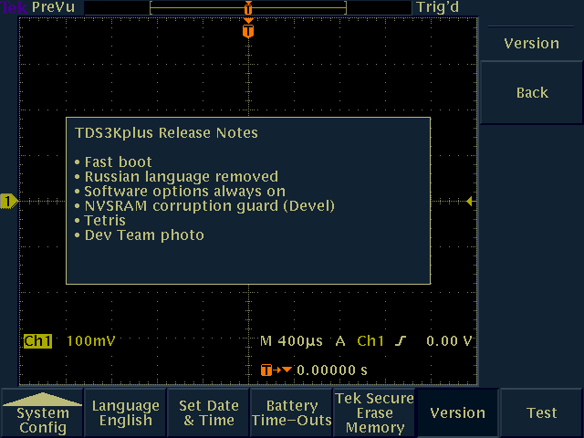
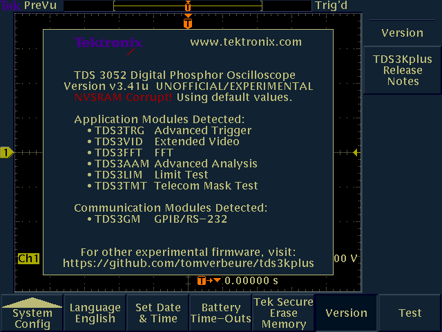
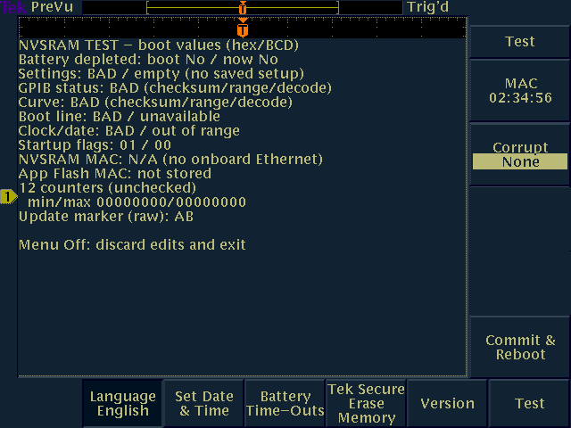
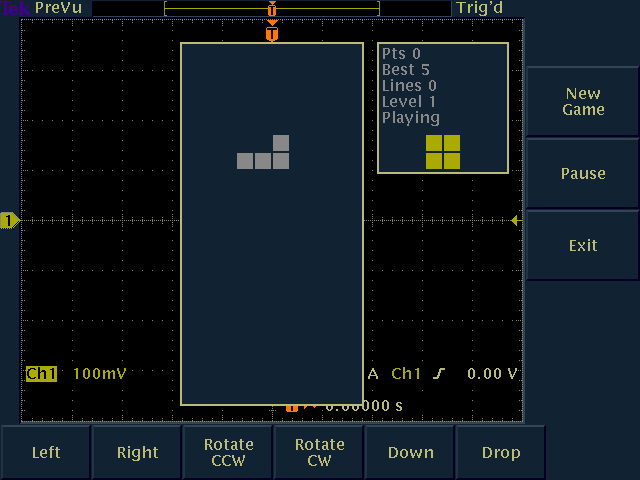

# TDS3Kplus

TDS3Kplus contains alternative firmware images for Tektronix TDS3000 and TDS3000B series oscilloscopes,
such as the TDS3052, TDS3014B, etc.  

The last official firmware for these oscilloscopes was version v3.41, released in 2007. It can still
be downloaded from their website. The images here are based on v3.41, but they have been patched to fix 
bugs, enable locked-down features, or even add new features. 

**They are unofficial, experimental, and absolutely not supported by Tektronix.
Use at your own risk and don't think about putting them on devices that are use in a professional
settings: they were made by hobbyists and are supposed to be hobbyists only.**

**WORK IN PROGRESS:**

Note all features are included in all firmware images. Use the 
*TDS3Kplus Release Notes* to check which features are included.

## New Feature - Fast Boot

When running the official firmware, it takes 17.3 s from pressing the power button to 
finishing application startup, 9.6 s of which are spent between power-on and
starting the main application in DRAM.

That's an awfully long time for a busy hobbyist and will not stand. If we don't want 
to touch the main application firmware, boot time optimization has to happen during 
those first 9.6 s.

Luckily, that's also the easiest code to touch, because the vast majority of the time
is spent doing [LZW](https://en.wikipedia.org/wiki/Lempel–Ziv–Welch) decompression, 
which, by today's standards, is known to be slow and to have mediocre compression. 
What if we replaced LZW with [LZ4](https://en.wikipedia.org/wiki/LZ4_(compression_algorithm)), 
which offers better compression and top-of-class decompression speed?

The bootloader is stored in the boot section of the flash and we definitely don't
want to touch that, so we can't avoid LZW decompression entirely but that's easily
solved with a third stage bootloader. The flow then looks like this:

1. Flash-based bootloader still copies original second stage bootloader to DRAM at location 0x0060_0000.
2. The second stage bootloader fetches the LZW-compressed third stage bootloader from the application
   section in flash, decompresses it and stores it at location 0x0000_6000.
3. The third stage LZ4 bootloader first relocates itself to location 0x0050_0000 and now fetches the
   LZ4-compressed main application code from flash, decompressed it and stores it at 0x0000_6000.
4. The main application is now ready to execute. Its contents in DRAM is exactly the same as
   the official case without a third stage bootloader.

Installing the third stage bootloader introduces a bit of overhead, but that's nothing compared
to the dramatic performance boost of LZ4 over LZW. In practice, the LZ4 compression reduces the
9.6 s to just 1.8 s and the overall boot time goes down from 17.3 s to 9.4 s. Much better!

Not only is this a quality of life improvement for users, it's also a great time saver for developers
who test firmware in the slow simulator. 

## New Feature: NVSRAM Guard

When the battery of the Dallas DS1742W dies, the real time clock (RTC) and the data in the
SRAM becomes corrupt. On the standard firmware, this often crashes the oscilloscope after
powering up due to a buffer overflow error.

This feature has a number of integrity checks. When it detects an issue, it prints an error
and boots up the oscilloscope with reasonable default values.

### Development mode

Developmenet versions of NVSRAM guard have a *secret* test menu that can deliberalty
corrupt the NVSRAM. When the Version status screen is active, press the "Select" 
button 4 times in a row and a "Test" menu button will appear.

## New Feature: Software Options Unlock

Before v3.41, the last official release, the TDS3000 had 6 optional advanced software-only
features that could be unlocked by purchasing a dongle. 

* TDS3TRG - Advanced Trigger
* TDS3VID - Extended Video
* TDS3FFT - FFT
* TDS3AAM - Advanced Analysis
* TDS3LIM - Limit Test
* TDS3TMT - Telecom Mask Test

They were not cheap, the list price of the TDS3AAM was $1,190!

Increase competition forced Tektronix to make TDS3TRG and TDS3FFT available without dongle
in release v3.41.  The TDS3000(B) series is now more than 20 years old, declared obsolete,
and Tektronix has stopped selling those dongle long time ago.

Enterprising hobbyists figured out how the dongles work. It's not complicated: they have a 
simple I2C PROM in which the name of the option is programmed. To unlock options, all you 
have to do is reprogram a now-useless TDS3FFT/TDS3AAM dongle or a small PCB with I2C PROM
yourself.

If the protection mechanism is that simple, the software can't be much more complicated and,
indeed, it's not. The new firmware permanently enables the 4 remaining locked software
options. Enjoy!

## New Feature: Tetris

Some old HP oscilloscopes have a Tetris Easter egg. It seemed wrong not to have such an essential
feature on the TDS3000, so I added it.

## New Feature: Development Team Photo

The internal development name of the TDS3000 was originally PacMan and was later
changed to Raptor. I know this because you can see that on the banner that's held
in front of the development team photo that's found in the flash. The main application 
firmware has a function that is dedicated only to decompressing this PNG image and rendering
it on screen, but there are no other functions to be found that call it.

To correct this injustice, I've added a menu button that calls this function.

[Dev Team Photo](./pics/dev_team_photo_full_screen.png)

# Removed Feature: Russian 

The uncompressed code and data of new features must be located somewhere. One option is to put 
code uncompressed in flash and execute it directly from there. I currently don't use this method,
but it's really not a bad idea: reads from flash are slower (80ns per 32-bit fetch) than DRAM 
(XXns per 32-bit fetch), but most of the new features are not performance critical and the 4KB instruction 
cache goes a long way to work around that. 

But we also need additional data buffers. In an embedded system with real-time requirements, 
it's common to statically allocate large buffers up front. The official firmware reserves a 96 KB buffer
for language assets: fonts, strings, graphics. These assets are stored in compressed format in flash 
and are decompressed and copied to that buffer on-the-fly. The size of the buffer is determined by 
the largest language asset, which happens to be Russian. It's remarkable that the second largest asset,
Japanese, is only 50 KB with more languages following closely behind. Disabling Russian as an option 
thus frees up 45 KB, enough for the new code and data.

There are definitely alternatives: the VxWorks RTOS of the firmware contains an interactive console for 
which input has been disabled. Similarly, there is a disabled PowerPC disassembler and even a microcode
disassembler for the Waveform Processing Unit (WPU) "shaders". And there are stretches of address
space that don't seem to be referenced by any code. 

But you'd need quite a bit testing to be sure that those regions are never used, unlike the language
asset buffer which is obviously sized for the largest language asset. So out goes Russian...

# Coming Soon: Serial Protocol Decoders

Modern oscilloscopes have built-in protocol decoders for I2C, RS-232, and SPI. The TDS3000
has none. A maximum recording depth of 10000 samples is not ideal for low bitrate protocol
decoding, but it's still better than nothing.

It's work in progress!

## Coming Soon: Feature: Model Change

Irrespective of their actual model number, all TDS3000 scopes use the same platform. The difference
between a 500 MHz/5 Gsps TDS3054 and 100 MHz/1.25 Gsps TDS3014 is a front panel sticker, a value
in the non-volatile data section of the flash, and some calibration parameters. 

Before the firmware version v3.41, it was possible to change the model number and thus the associated
specification over GPIB with the PITBULL command. v3.41 removed that, so you had to go downgrade the
scope firmware to upgrade the model number and then upgrade the scope firmware back to v3.41.

Not anymore! The new firmware adds a way to change the model number with a simple menu. To make sure
your toddler doesn't accidentally do this by mashing random buttons, this menu button is hidden
by default. You must press the Select button 4 times in a row when you're in the XXX menu to make
it appear.

A word of caution: it is *possible* that lower spec model are using ASICs that didn't pass the testing 
requirements of higher models, but I doubt it: it would be unusual to have different parameters for a 
chip that has the same name on the package. Still do this at your own risk, which applies to this
new firmware in general anyway. And make sure to rerun SPC calibration after changing the model number.

